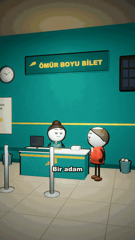
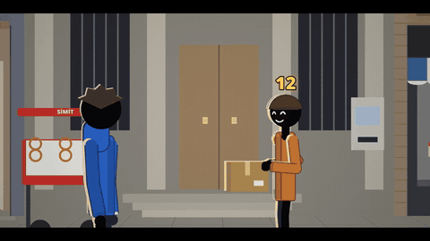
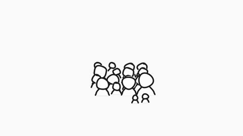
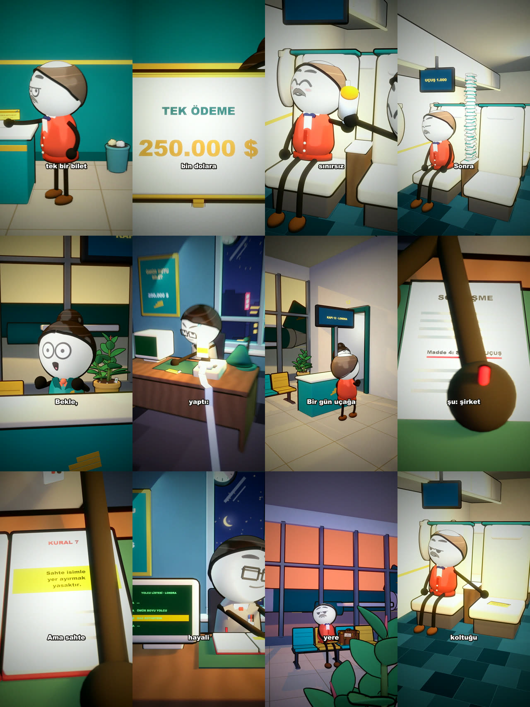
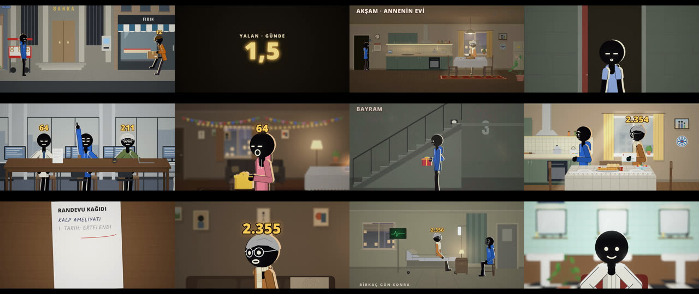
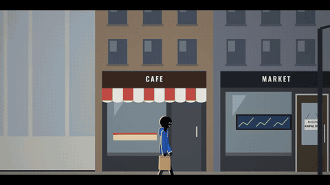
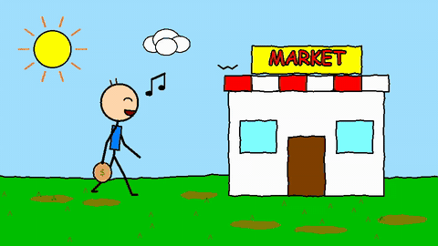
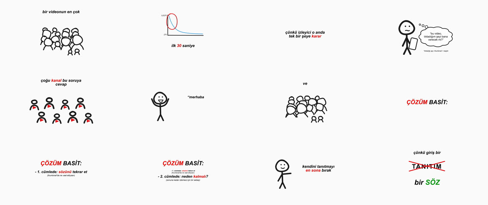

# Claude Viral Animasyon Şablonu

**Claude Code ile baştan sona animasyonlu video üretim stüdyosu**: konu → araştırma → senaryo → seslendirme → sahne
sahne animasyon → müzik/efekt → MP4. 12 farklı animasyon stili, viral kanallardan tersine mühendislikle çıkarılmış
12 Claude skill'i ve özel bir whiteboard stili (dmscales) içerir.


<p align="center">
  
  
  
</p>

---

## İçindekiler

- [Ne yapar?](#ne-yapar)
- [Stiller ve örnek videolar](#stiller-ve-örnek-videolar)
- [Kurulum](#kurulum)
- [Video yapmak (adım adım)](#video-yapmak-adım-adım)
- [Claude ile konuşarak çalışmak](#claude-ile-konuşarak-çalışmak)
- [Skill'ler](#skiller)
- [Özel stil: dmscales](#özel-stil-dmscales)
- [Klasör yapısı](#klasör-yapısı)
- [Bu repoda neler yok (ve neden)](#bu-repoda-neler-yok-ve-neden)

---

## Ne yapar?

Toon Studio, animasyon motorunu pencere açmadan bir kütüphane gibi yükler; render için headless Chrome sayfaları
kullanılır ([`appcore/load.cjs`](appcore/load.cjs)). Böylece:

- Her adım hazır bir üretim hattıyla çalışır: Claude istemleri, ekip ajanları, araçlar,
  model/efor kuralları (Ultraedit'te Opus), aynı kare bütçesi.
- Her şey **terminalden ve Claude Code'dan** yönetilir: `python studio.py <komut>`.
- Uzun işler (build, export) arka planda çalışabilir; Claude Code oturumu bunları kendisi başlatıp takip eder.
- `suite` MCP sunucusu, motorun Claude araçlarını (render_frames, check_layout, make_image …) Claude Code'a açar.

```
konu ─▶ run script ─▶ voice ─▶ run build ─▶ run edit ─▶ sound ─▶ export ─▶ out/<ad>.mp4
         (araştırma     (ElevenLabs   (Claude sahne     (düzelt-     (müzik +   
          + senaryo)     + zamanlama)  sahne kodlar)     meler)       efekt)    
```

---

## Stiller ve örnek videolar

`python studio.py styles` ile listelenir. Aşağıdaki örneklerin hepsi bu stüdyoda, bu komutlarla üretildi.

### 🎬 Blender 3D cartoon — `blender`

Büyük kafalı çizgi film karakterleri, tam döşenmiş ve ışıklandırılmış 3D setler, Blender'da render. Dikey (9:16) Shorts
için ideal.

<p align="center"></p>

▶ [Örnek video: "Ömür Boyu Bilet" (58 sn, 9:16)](docs/media/blender.mp4)

### ✏️ Stick stories — `stickstory`

"Ya sen … olsaydın?" hikâyeleri: resimli setlerde siyah çöp adamlar, kafa üstü sayılar, HUD grafikleri, haritalar ve
diyagramlar.

<p align="center"></p>
<p align="center"></p>

▶ [Örnek video: ilk 60 sn (16:9)](docs/media/stickstory.mp4)

### 🖍️ MS Paint çöp adam — `stickman`

MS Paint ile çizilmiş gibi büyük kafalı çöp adamlar, komik tarih ve bilim anlatımları, 2–3 saniyede bir yeni resim.

<p align="center"></p>

▶ [Örnek video: "Market kapalı" (9 sn, 16:9)](docs/media/stickman.mp4)

### 🖊️ dmscales whiteboard — `custom-dmscales` (özel stil)

Beyaz sayfa, kelimesi gelince "pat" diye çıkan italik yazı, kırmızı anahtar kelimeler, marker çöp adam figürleri. @dmscales
açıklayıcılarından ölçülerek çıkarıldı (bkz. [Özel stil: dmscales](#özel-stil-dmscales)).

<p align="center"></p>

▶ [Örnek video: "İlk 30 saniye" (30 sn, 16:9)](docs/media/dmscales.mp4)

### Tüm stiller

| ID | Stil | Ne için |
|---|---|---|
| `blender` | 3D cartoon (Blender) | Büyük kafalı çizgi karakterler, zengin döşenmiş, tam ışıklı 3D setler |
| `toon` | 3D cartoon shorts | İfadeli 3D çizgi karakterler, her cümlede yeni plan (tarayıcıda render) |
| `stickstory` | Stick stories | "What if you…" hikâyeleri, çöp adamlar, HUD, harita, diyagram |
| `stickman` | MS Paint çöp adam | MS Paint görünümlü komik tarih/bilim anlatımları, 2–3 sn'de bir yeni resim |
| `flat` | Flat explainer | Kendi karakterinle parlak flat-vektör bilim anlatımları (9:16 / 16:9) |
| `pixel-art` | Pixel art | Three.js sahneleri, keskin düşük çözünürlüklü pixel art olarak |
| `lowpoly` | Low poly shorts | Hızlı low-poly 3D shorts, oyun karakterleri, 1,5–2,5 sn'de bir yeni resim |
| `recon` | 3D rekonstrüksiyon | Gerçek olayların belgesel canlandırması: kil 3D ya da karanlık sinematik soruşturma |
| `mega` | 3D Informational | Blender'da gerçekçi 3D mühendislik anlatımları, yeşil X-ray vurgular |
| `collage` | Vox (gazete kolajı) | Tek gazete sayfası üstünde kesik-kolaj açıklayıcılar |
| `vox` | Vox editorial (eski) | Katmanlı kâğıt kolaj belgeseller |
| `custom-dmscales` | dmscales (özel) | Whiteboard açıklayıcı, kelimede beliren italik yazı, kırmızı vurgular |

**Kalite seviyeleri** (`--level`): `standard` → `props` → `polish` → `scenes` (Verified) → `ultra` (Ultraedit, Opus) →
`ultraplus` (sadece rekonstrüksiyon). Bir projenin seviyeleri: `python studio.py levels <ad>`.

---

## Kurulum

### Gereksinimler

| | |
|---|---|
| **Claude Code** | `claude` komutu çalışır durumda, giriş yapılmış |
| **Node.js ≥ 22** | motor `node:sqlite` kullanır |
| **Python 3.10+** | + `pip install pillow` |
| **Google Chrome** | render sayfaları headless Chrome'da çalışır |
| **ffmpeg** | ses ve video için |
| Blender 5.2.3 | sadece `blender` / `mega` stilleri için |

### Adımlar

```bash
git clone https://github.com/beratmemisoglu/claude-viral-animasyon-sablonu.git berat-studio
```

```bash
cd berat-studio
```

```bash
python setup_from_app.py --data "<veri klasörü>"
```

- `--data`: ayarların (`config.json`), Flow profilinin ve konuşma modellerinin olduğu veri klasörü.
- `--workspace` (isteğe bağlı): projelerin tutulacağı klasör, varsayılan `~/ToonStudio-Projects`.

`setup_from_app.py` şunları yapar:

1. Veri klasöründen ayarlarını (`appdata/config.json`: ses, müzik, Claude), Google Flow profilini, konuşma
   modellerini ve Blender'ı bağlar.
2. `studio.json` (Python, Chrome, çalışma alanı yolu) ve `.mcp.json` (suite MCP sunucusu) dosyalarını yazar.

### API anahtarları

Anahtarlar **sadece ortam değişkenlerinden** okunur, hiçbir dosyaya yazılmaz:

| Değişken | Ne için |
|---|---|
| `ELEVENLABS_API_KEY` | seslendirme (`voice`) |
| `HIGGSFIELD_API_KEY` | AI görsel/video |
| `FAL_KEY` | AI görsel |
| `FISH_AUDIO_API_KEY` | alternatif seslendirme |

Windows (PowerShell, kalıcı):

```powershell
setx ELEVENLABS_API_KEY "anahtarın"
```

Kontrol:

```bash
python studio.py styles
```

---

## Video yapmak (adım adım)

```bash
# 1) Proje
python studio.py new filmim --style stickstory --length 120 --format landscape --lang tr

# 2) Senaryo: araştırma + research.md + script.txt (ya da script.txt'yi kendin yaz)
python studio.py run filmim script --notes "konu, açı, notlar"

# 3) Seslendirme: ElevenLabs + otomatik temizleme ve kelime zamanlaması
python studio.py voice filmim
#    kendi kaydın:  python studio.py voice filmim --provider file --file ses.wav

# 4) Animasyon: Claude sahne sahne kodlar, render alır, kontrol eder
python studio.py run filmim build --level scenes

# 5) Düzeltme
python studio.py run filmim edit --notes "1:20'deki sahnede karakter kapıdan girsin"

# 6) Müzik/efekt ve dışa aktarma -> projenin out/filmim.mp4 dosyası
python studio.py sound filmim
python studio.py export filmim
```

| Komut | Ne yapar |
|---|---|
| `styles` / `looks <stil>` | stiller / bir stilin görünüm önayarları |
| `list` | çalışma alanındaki projeler |
| `new <ad> --style <id> [...]` | yeni proje (`--length`, `--format vertical\|landscape`, `--lang`, `--look`, `--topic`, `--brief`) |
| `import <klasör>` | başka yerde açılmış bir proje klasörünü kaydet |
| `run <ad> script\|build\|edit\|ask\|ultra` | Claude Code'u üretim hattının istemleri ve araçlarıyla çalıştırır |
| `voice <ad>` / `audio <ad>` | seslendirme / sadece temizle + zamanla |
| `sound <ad>` | müzik ve efektler |
| `export <ad> [--stems] [--silent]` | MP4 (`--silent`: ses izi yok) |
| `stills <ad> <t> [t ...]` | belirli saniyelerden kare al |
| `flow-open` | Google Flow penceresini aç (giriş / robot kontrolünü sen tamamla) |
| `kit [klasör]` / `import-style <zip>` | Style Kit'i yaz / özel stil paketi ekle |

İpuçları:

- `build`, `export`, `voice` dakikalar–saatler sürebilir; Claude Code'a "arka planda çalıştır" de.
- **Sessiz video**: `voice`'u atla, `audio/timeline.json` + `audio/script_timed.txt` + sessiz `audio/clean.wav` yaz,
  `run <ad> build`, sonra `export <ad> --silent`.
- `appcore/fixes.cjs`: motora eklenen düzeltmeler (stickstory/toon export'undaki "Encoding error" için encoder
  yedeği); her komut projenin `engine.js` dosyasına otomatik uygular.

---

## Claude ile konuşarak çalışmak

Claude Code'u bu klasörde aç ve ne istediğini söyle: *"stickstory stilinde, 'Ya herkesin kafasının üstünde yalan sayısı
olsaydı?' konulu 2 dakikalık Türkçe video yap"*. [`CLAUDE.md`](CLAUDE.md) Claude'a tüm akışı anlatır.

Belli bir proje üzerinde araçlarla çalışmak için:

```bash
python studio.py use filmim
```

Sonra Claude Code'da `/mcp` ile `suite` sunucusunu yeniden bağla. Motorun araçları (render_frames, check_preview,
check_layout, list_shots, make_image, web_image, library_* …) o projede çalışır.

---

## Skill'ler

[`skills/`](skills) klasöründeki her skill, belirli bir viral kanalın/formatın kare kare, transkript ve metriklerle
tersine mühendisliğinden çıkarılmış bir üretim sistemidir. Kurmak için `~/.claude/skills/` içine kopyala:

```bash
cp -r skills/* ~/.claude/skills/
```

| Skill | Ne üretir |
|---|---|
| [`dmscales-explainer-dna`](skills/dmscales-explainer-dna) | "The Entire X Explained in N Seconds" tarzı sistem/algoritma açıklayıcıları: konu → araştırma → Türkçe senaryo → QC → başlık/thumbnail → edit-plan |
| [`whatif-animated-dna`](skills/whatif-animated-dna) | "Ya ___ olsaydı?" animasyonlu hipotetik videolar: fikir → başlık → senaryo → shot list → Remotion render → metadata |
| [`viral-anim-reels`](skills/viral-anim-reels) | Yüzsüz animasyonlu "gizli kural / loophole" Reels & Shorts fabrikası, IG büyüme planı ve KPI |
| [`lowbudgetstories-dna`](skills/lowbudgetstories-dna) | "Life of a …" / "Origin of …" sözsüz pantomim hiciv hikâyeleri, kesme ritmi + ses QA |
| [`sim-explainer-dna`](skills/sim-explainer-dna) | Kuşbakışı simülasyon + veri grafiği bilim açıklayıcıları (brif → tam üretim paketi) |
| [`aiflow-video-dna`](skills/aiflow-video-dna) | Ekran kaydı tutorial'ı ve yüzsüz maskotlu finans videosu kurgusu, EDL, edit-ritmi QA |
| [`inner-voice-film`](skills/inner-voice-film) | "The Other Self" kısa animasyon filmleri (Remotion + SVG karakter + ElevenLabs iç ses) |
| [`other-self-thumbnail`](skills/other-self-thumbnail) | Bu filmler için thumbnail beyni ve SVG/Higgsfield üreticisi + mobil okunabilirlik QA |
| [`daily-film-pipeline`](skills/daily-film-pipeline) | Günlük otomatik üretim: fikir → film → thumbnail → YouTube yükleme → rapor |
| [`competitor-radar`](skills/competitor-radar) | YouTube Data API ile günlük rakip taraması ve özgün film fikirleri |
| [`lbb-content-dna`](skills/lbb-content-dna) | Kitap özeti / self-help senaryo üretimi ve denetimi (hook, retention, paketleme) |
| [`lbb-deep-research`](skills/lbb-deep-research) | Bu senaryolar için kaynaklı derin araştırma dosyası |

Bazı skill'ler kendi API anahtarlarını ister (YouTube Data API, ElevenLabs, Higgsfield); her skill'in `SKILL.md`
dosyasına bak.

---

## Özel stil: dmscales

`custom-dmscales`, @dmscales açıklayıcılarının görünüm ve hareketinin ölçülerek Style Kit ile yeniden
kurulmuş hâlidir. Araştırma raporları: [`research/dmscales`](research/dmscales) (`visual.md`, `motion.md`,
`script_audio.md`). İnceleme ve onay kaydı: [`styles/dmscales/REVIEW.md`](styles/dmscales/REVIEW.md).

- **Görünümler**: Clean (son videolar) ve Hit (en çok izlenen iki video: kalın italik, #fcfcfc). Kontrol: `era`.
- **Repoda olanlar**: stilin kendi parçaları: `models.js` (öğeler), `scenes/`, `looks/`, `skill/`, `style.json`.
- **Repoda olmayanlar**: Style Kit'in motoru (`engine.js`, `lib/`, `vendor/`): Style Kit şartları gereği yayınlanamaz.

Stili kendi Style Kit'ine kurmak:

```bash
python studio.py kit
```

Style Kit klasöründe `./cz new dmscales --base starter --aspects 16:9,9:16 --dim 2d` ile stili oluştur, bu repodaki
`styles/dmscales/` dosyalarını üstüne kopyala, sonra `./cz check dmscales` ve `./cz package dmscales`. Çıkan
`dist/custom-dmscales.zip`'i ekle:

```bash
python studio.py import-style "<Style Kit>/dist/custom-dmscales.zip"
```

Bir dmscales videosu:

```bash
python studio.py new algoritma --style custom-dmscales --look custom-dmscales-hit
python studio.py voice algoritma --provider file --file ses.wav
python studio.py run algoritma build
```

---

## Klasör yapısı

```
├── studio.py              komut satırı (python studio.py help)
├── setup_from_app.py      veri klasörünü bağlar, studio.json yazar
├── CLAUDE.md              Claude Code için akış talimatları
├── appcore/
│   ├── load.cjs           Electron yerine geçen yükleyici (headless Chrome, nativeImage, ortam değişkeni anahtarları)
│   ├── cli.cjs            studio.py'nin çağırdığı komutlar
│   ├── mcp.cjs            suite MCP sunucusu (motorun Claude araçları)
│   └── fixes.cjs          motora eklenen düzeltmeler
├── skills/                12 Claude skill'i
├── styles/dmscales/       dmscales stilinin kendi parçaları
├── research/dmscales/     dmscales ölçüm raporları
└── docs/media/            README örnek görselleri ve videoları
```

Kurulumdan sonra eklenenler (git'e girmez): `appdata/`, `studio.json`, `.mcp.json`.

---

## Bu repoda neler yok (ve neden)

| Yok | Neden |
|---|---|
| `templates/blender/`, `templates/lowpoly/` ve diğer büyük asset klasörleri | 100 MB üstü; Git LFS gerektirirdi |
| Blender | 400 MB; ayrıca kurulur |
| Style Kit motoru (`styles/*/engine.js`, `lib/`, `vendor/`) | üçüncü tarafa ait |
| `appdata/` (ayarlar, Google Flow girişi, konuşma modelleri) | kişisel ve gizli |
| API anahtarları | sadece ortam değişkenlerinde |
| Analiz edilen kanalların videoları, transkriptleri, thumbnail'leri | onların malı; skill'lerde sadece analizler var |

## Lisans

Bu repo [MIT Lisansı](LICENSE) ile yayınlanmıştır.

**Ticari kullanım ve dağıtım dahil her türlü kullanıma açıktır**: kopyalayabilir, değiştirebilir, satabilir,
dağıtabilir, kendi ürünlerinize gömebilirsiniz; tek koşul LICENSE dosyasındaki telif hakkı bildiriminin korunmasıdır.

Style Kit motoru (`styles/*/engine.js`, `lib/`, `vendor/`) kendi şartlarına tabidir.
